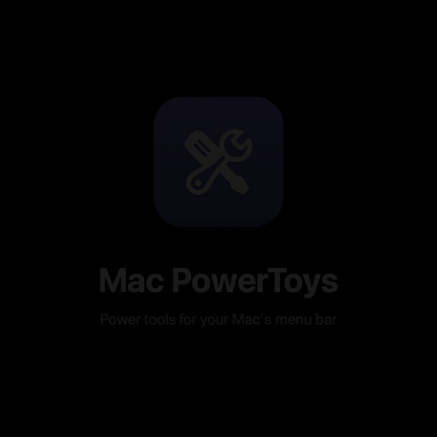

# ⚙️ Mac PowerToys

A collection of powerful utilities for macOS, accessible from your menu bar. Inspired by Microsoft PowerToys.




Twenty productivity tools, from a screen ruler and color picker to a clipboard manager, PDF toolkit and local speech-to-text, in a single menu-bar popover.

## ✨ Features

### 🎨 Color Picker
- 🎯 **Screen Color Picker**: Pick any color from your screen with the eyedropper (Global Shortcut: `⌃⌥C`)
- 🎨 **Native Color Panel**: Open the built-in macOS color panel
- 🎨 **Multiple Formats**: HEX, RGB, HSL and HSV values, each one click to copy
- 🌈 **Color Shades**: See variations of the selected color
- 📚 **Color History**: Keep your last 8 picked colors

### 📏 Screen Ruler
- 📐 **Measure Anything**: Measure distances on screen in real device pixels, Retina-aware (Global Shortcut: `⌃⌥R`)
- 🎯 **Edge Detection**: Snaps to edges found in the screen contents, with adjustable pixel tolerance and optional per-channel detection
- 📏 **Four Modes**: Bounds, Spacing, Horizontal and Vertical (switch with `⌘1`–`⌘4`)
- 📎 **Physical Units**: Optionally show inches, centimeters or millimeters based on the display's reported physical size
- 📋 **Quick Copy**: Click to copy the measurement to the clipboard

### 🔍 ZoomIt
- 🔎 **Screen Zoom**: Freeze and magnify the screen, then pan around (Global Shortcut: `⌃⌥Z`)
- 🎥 **Live Zoom**: Real-time magnification that follows your cursor (Global Shortcut: `⌃⌥L`)
- ⚙️ **Adjustable Zoom**: 1.25x to 4x, adjustable with a slider or the scroll wheel
- ✨ **Animated Zoom**: Optional smooth zoom-in and zoom-out transition

### ✍️ Screen Annotation
- 🖌️ **Draw on Screen**: Freehand, line, arrow, rectangle, ellipse and text tools (Global Shortcut: `⌃⌥D`)
- 🎨 **Color & Width**: Pick a color and a line width from the on-screen toolbar
- 🌑 **Dim Background**: Optionally darken the screen for better visibility
- ↩️ **Undo & Edit**: `⌘Z` or right-click to undo; select an annotation to move it or delete it with `⌫`
- 💾 **Save**: Save the annotated screen as a PNG to your Desktop

### 📸 Screen Capture
- ✂️ **Area Capture**: Press `⌃⌥4` and drag to select a region
- 📋 **Clipboard First**: The captured image is copied to the clipboard as PNG
- 🔐 **ScreenCaptureKit**: Uses the system capture API and guides you to Screen Recording permission if needed

### 🖱️ Mouse Utilities
- 🔦 **Find My Mouse**: Dims the screen and spotlights your cursor (double-tap `Left Control`; `Right Control` selectable)
- 🖍️ **Mouse Highlighter**: Visual indicators for left and right clicks (double-tap `Left Option`)
- ➕ **Mouse Crosshairs**: Full-screen crosshairs centered on your cursor (double-tap `Right Option`)
- 🔄 **Cursor Wrap**: Cursor jumps to the opposite screen edge, horizontally and/or vertically
- 🎛️ **Customizable**: Colors, opacity, radius and timing are adjustable for each tool

### 📋 Clipboard Manager
- 📝 **History Tracking**: Keeps text and image clips
- 🔍 **Searchable**: Quickly find past clips
- 📌 **Pin Items**: Pinned items survive "clear history"
- 🔒 **Respects Password Managers**: Skips concealed, transient and auto-generated clipboard content
- ⌨️ **Global Shortcut**: Open your history with `⌃⌥V`
- ⚙️ **Customizable Limit**: Keep 10, 25, 50 or 100 items

### ⚡ Quick Launch
- 🔎 **Command Palette**: Press `⌃⌥Space` for a fuzzy-search palette that finds installed apps and every module's actions
- 🚀 **Custom Shortcuts**: Add your own entries that open apps, files, folders, URLs or run shell commands
- 📈 **Frecency Ranking**: Results are ranked by how often and how recently you use them
- ⌨️ **Keyboard-Driven**: `↑↓` navigate, `↩` run, `⌘↩` open the module's settings, `Esc` close

### ☕ Awake
- 🚫 **Prevent Sleep**: Keep your Mac awake indefinitely or for a set time
- 🖥️ **Display Control**: Keep the display on, or let only the system stay awake
- ⏱️ **Timed Mode**: 15m, 30m, 1h, 2h or 4h

### 🖱️ Mouse Jiggler
- 🏃 **Stay Active**: Simulates tiny mouse movements to prevent "Away" status in apps like Teams, Slack and Zoom
- ⚙️ **Adjustable Interval**: 10s to 120s
- 🔐 **Accessibility**: Needs Accessibility permission to move the cursor

### 🍅 Pomodoro Timer
- ⏱️ **Focus Cycles**: Customizable focus (default 25 min), short break (5 min) and long break (15 min) lengths
- 🔁 **Long Break Cycle**: Long break after 2–8 focus sessions (default 4)
- 🔄 **Auto-Transitions**: Optionally auto-start breaks and the next focus session
- 🔔 **Notifications & Sound**: macOS notification and optional sound at the end of each phase
- 📊 **Session Tracking**: Counts completed focus sessions

### ⌨️ Markdown Preview
- 👁️ **Live Preview**: Open and preview Markdown files in a resizable window with GitHub-flavored styling
- 🔄 **Auto-Reload**: Preview updates when the file changes on disk
- 📋 **Paste from Clipboard**: Preview Markdown without opening a file
- 📄 **PDF Export**: Export the rendered document as PDF from the window toolbar
- 🌗 **Theme Toggle**: Switch between light and dark themes
- 📂 **Recent Files**: Quick access to recently opened files

### 📄 PDF Tools
- 🧩 **Merge**: Combine multiple PDFs into one
- ✂️ **Split**: By page ranges (e.g. `1-5, 8, 10-15`), every N pages, or every page
- 🗜️ **Compress**: High, Medium or Low quality
- 🔄 **Rotate**: Rotate pages of a PDF
- 🖼️ **PDF to Images**: Export pages as PNG, JPEG or TIFF at 72, 150 or 300 DPI
- 📑 **Images to PDF**: Build a PDF from images
- 📜 **History**: Recent operations with "Reveal in Finder"

### 🖼️ Image Optimizer
- 📥 **Batch Input**: Drop or browse JPEG, PNG, WebP and HEIC images
- 🗜️ **Compress**: Adjustable quality; output as Original, JPEG, PNG or WebP
- 📐 **Resize**: By pixel width and height (optionally keeping aspect ratio) or by percentage
- 📊 **Estimate & Compare**: Estimated output size and a before/after preview
- 🛡️ **Non-Destructive**: Saves `<name>_optimized.<ext>` next to the original

### 🎬 Video Converter
- 🔄 **FFmpeg-Powered**: Convert between 16 formats: 9 video (MP4, MOV, M4V, MKV, WEBM, AVI, FLV, WMV, 3GP), 6 audio (MP3, AAC, WAV, FLAC, M4A, OGG) and animated GIF
- 🎚️ **Quality Presets**: Low, Medium, High or Highest
- 📐 **Resolution Options**: Original, 4K, 1440p, 1080p, 720p, 480p or 360p
- 🎵 **Audio Extraction**: Extract audio tracks from video files
- 📊 **Real-time Progress**: Live progress with cancel support
- 📂 **Drag & Drop**: Drop files onto the converter or browse
- 🔍 **File Analysis**: Metadata extraction (duration, resolution, codec, frame rate, size)
- 📜 **Conversion History**: Recent conversions with "Show in Finder"
- 🍺 **One-Click FFmpeg Install**: Detects Homebrew and installs FFmpeg for you

### 🎙️ Speech to Text
- 🗣️ **Whisper Transcription**: Transcribe audio and video files with WhisperKit
- 🧠 **Model Choice**: Tiny, Base, Small, Medium or Large v3
- 🌍 **Languages**: Auto-detect or pick from 98 languages
- 📝 **Output**: Plain or timestamped text; copy or save as a text file
- 📂 **Drag & Drop**: Drop files or browse (MP3, WAV, AIFF, MP4, MOV and more)

### 🔌 Port Manager
- 📡 **Listening Ports**: Live list of TCP ports in LISTEN state, with process name and PID
- 🔍 **Search, Sort & Filter**: By port, name or PID; filter System, User or Dynamic ports
- 📈 **Per-Port Details**: Network traffic and active connections
- 🛑 **Terminate**: Send SIGTERM or SIGKILL after confirmation
- 📋 **Copy**: Copy port, PID, process name, details or a ready-made `lsof` command
- ⏱️ **Refresh Interval**: 1, 2, 5 or 10 seconds

### 📊 System Info
- 🖥️ **Live Metrics**: CPU, memory, disk and network (up/down) usage
- ⏱️ **Refresh Interval**: 1, 2 or 5 seconds

### 🪄 Test Data Generator
- 🔢 **UUID**: Random UUID
- 👤 **Random Name** and 📅 **Random Date**
- 📝 **Lorem Ipsum**: Short, medium or long
- 📋 **Auto-Copy**: Every result goes straight to the clipboard

### 🔔 GitHub Notifier
- 🔐 **Secure Sign-in**: GitHub device-flow login or a personal access token, stored in the Keychain
- 👀 **Watch What Matters**: Choose repositories and organizations to watch
- 🎯 **Event Filters**: Pushes, pull requests, reviews, issues, comments, releases, forks, stars, branch/tag create and delete
- ⏱️ **Polling**: Every 1, 2, 5 or 10 minutes, or "Poll Now"
- 🔔 **Native Notifications**: macOS notifications with optional sound

### General
- ⚡ **Menu Bar Hub**: A 340×640 pt popover with a card grid, per-tool toggles and live status
- 🔎 **Command Palette**: `⌃⌥Space` reaches any tool from anywhere (see Quick Launch)
- 🚀 **Launch at Login**: One-click toggle in the hub
- 💾 **Settings Persistence**: Tool settings are saved between launches
- 🌗 **System Appearance**: Uses native SwiftUI controls and system colors
- 🔐 **Permission Guidance**: Prompts for Accessibility (global shortcuts) and Screen Recording when needed

## 📋 Requirements

- **macOS 15.5 or later**
- Apple Silicon or Intel Mac
- **FFmpeg** (optional, required for Video Converter — installable via Homebrew from within the app)

## 🚀 Installation

### Homebrew
```bash
brew tap rbinar/tap
brew trust rbinar/tap   # newer Homebrew versions require trusting third-party taps
brew install --cask mac-powertoys
```

### Download from Releases
1. Download the latest `MacPowerToys-v*.dmg` from [Releases](https://github.com/rbinar/mac-powertoys/releases)
2. Open the DMG file
3. Drag `MacPowerToys.app` to your Applications folder
4. Launch from Applications or Spotlight

> **First launch:** this build is signed but not yet notarized by Apple, so macOS blocks it the first time. Try to open the app, then go to **System Settings → Privacy & Security** and click **Open Anyway**.

### Build from Source
```bash
git clone https://github.com/rbinar/mac-powertoys.git
cd mac-powertoys
open MacPowerToys.xcodeproj
```

## 🎯 Usage

1. **Launch the app** - A wrench-and-screwdriver icon appears in your menu bar
2. **Click the menu bar icon** to open the Mac PowerToys feature hub
3. **Select a tool** from the hub, or use global shortcuts (each tool must be enabled; shortcuts need Accessibility permission):

   | Shortcut | Action |
   |---|---|
   | `⌃⌥Space` | Quick Launch command palette |
   | `⌃⌥C` | Color Picker |
   | `⌃⌥R` | Screen Ruler (`Esc` to exit) |
   | `⌃⌥Z` | Screen Zoom (`Esc` to exit) |
   | `⌃⌥L` | Live Zoom (`Esc` to exit) |
   | `⌃⌥D` | Screen Annotation (`Esc` to exit) |
   | `⌃⌥4` | Screen Capture to clipboard (`Esc` to cancel) |
   | `⌃⌥V` | Clipboard Manager |
   | Double-tap `Left Control` | Find My Mouse (`Right Control` selectable) |
   | Double-tap `Left Option` | Mouse Highlighter |
   | Double-tap `Right Option` | Mouse Crosshairs (`Esc` to turn off) |

   (`⌃` Control, `⌥` Option, `⌘` Command)

4. **Toggle-style tools**: Awake, Mouse Jiggler, Pomodoro Timer, Cursor Wrap, Port Manager, System Info and GitHub Notifier run when switched on from their hub card
5. **File-based tools**: Markdown Preview, PDF Tools, Image Optimizer, Video Converter and Speech to Text work on files you open or drop in
6. **Screen Ruler**: Press `⌘1`–`⌘4` while active to switch modes; scroll to adjust tolerance; click to copy
7. **Screen Annotation**: Pick a tool in the toolbar; `⌘Z` or right-click to undo; `⌫` deletes the selected annotation

## 🛠️ Development

This app is built with:
- **SwiftUI** for the user interface
- **AppKit** for macOS integration (overlay windows, event monitors, `NSColorSampler`, `NSColorPanel`)
- **Carbon** hotkeys (`RegisterEventHotKey`) for global shortcuts
- **ScreenCaptureKit** for ZoomIt and Screen Capture
- **PDFKit** for PDF Tools
- **ImageIO** for Image Optimizer
- **WebKit** for Markdown Preview
- **AVFoundation** for media file analysis
- **WhisperKit** (Swift Package) for Speech to Text
- **FFmpeg** (via `NSUserUnixTask`) for video/audio conversion
- **ServiceManagement** for Launch at Login, **UserNotifications** for alerts

Build and test:
```bash
xcodebuild -project MacPowerToys.xcodeproj -scheme MacPowerToys -configuration Debug build
xcodebuild -project MacPowerToys.xcodeproj -scheme MacPowerToys \
  -destination 'platform=macOS' CODE_SIGNING_ALLOWED=NO \
  -only-testing:MacPowerToysTests test
```

## 🤝 Contributing

Contributions are welcome! Please feel free to submit a Pull Request.

## 📄 License

This project is licensed under the MIT License - see the LICENSE file for details.

## ⭐ Support

If you find this app useful, please consider giving it a star on GitHub!
